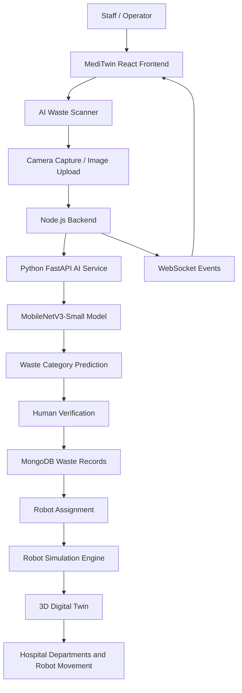
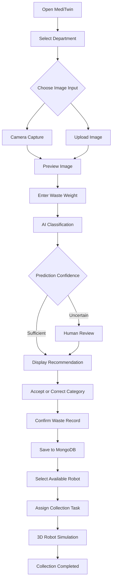

# MediTwin

### AI-Powered Biomedical Waste Management System with 3D Digital Twin and Robotic Simulation

\<p align="center">   \<b>Smart Healthcare Waste Segregation | AI Classification | Intelligent Robot Simulation | Digital Twin\</b> \</p>

## Overview

MediTwin is an AI-powered biomedical waste management system designed to improve biomedical waste segregation, monitoring, and collection in healthcare environments.

The system uses deep learning-based image classification to identify biomedical waste and recommend the appropriate colour-coded disposal category. Healthcare staff can capture images using a camera or upload existing images for AI analysis.

After AI classification, staff must verify or correct the predicted category before a waste record is saved and a simulated robot is assigned for collection.

MediTwin also features an interactive 3D Digital Twin of a hospital environment, where simulated robots move between departments, perform collection tasks, and update their operational status.

The project combines Artificial Intelligence, Computer Vision, Web Development, Database Management, Robotics Simulation, and 3D Visualization into one integrated platform.

---

## Key Features

### 1. AI-Based Biomedical Waste Classification

- Image classification using MobileNetV3-Small.
- Transfer learning with an ImageNet-pretrained backbone.
- Recognition of four biomedical waste categories.
- Confidence score and alternative predictions.
- Entropy-based uncertainty assessment.
- Human verification before saving a classification.
- Low-confidence predictions are sent for manual review.

### 2. Camera Capture and Image Upload

Users can submit waste images using two methods:

- **Camera Capture:** Capture biomedical waste images directly using a device camera.
- **Image Upload:** Upload images from a computer or mobile device.

Supported image formats include JPG, JPEG, PNG, and WEBP, subject to backend validation.

Both methods use the same AI classification pipeline.

### 3. Four-Category Biomedical Waste Segregation

MediTwin follows the colour-coded biomedical waste segregation framework under India's Biomedical Waste Management Rules, 2016, and applicable amendments.

| Category | Bin Colour        | Waste Examples                                                                                         |
| -------- | ----------------- | ------------------------------------------------------------------------------------------------------ |
| Yellow   | Yellow            | Human tissues, blood-soaked cotton, bandages, contaminated dressings and specified discarded medicines |
| Red      | Red               | Contaminated recyclable plastics, IV tubes, catheters, urine bags and gloves                           |
| White    | Translucent White | Used needles, blades, scalpels and other contaminated sharps                                           |
| Blue     | Blue              | Specified contaminated glassware, medicine vials, glass ampoules and metallic implants                 |

**Important:** Special waste exceptions, cytotoxic waste, chemical waste and uncertain classifications require appropriate handling and human review. General municipal waste must not be automatically classified as biomedical waste.

### 4. Human Verification System

AI predictions are advisory.

The workflow requires a human operator to:

1. Review the AI prediction.
2. Check the recommended category.
3. Accept the prediction or correct it.
4. Confirm the final category.
5. Save the verified waste record.

The system maintains separate information for AI-predicted and human-confirmed categories.

### 5. Intelligent Robot Assignment

MediTwin provides three simulated collection robots:

- MB-01
- MB-02
- MB-03

Features include:

- Manual robot selection.
- Robot availability monitoring.
- Battery status.
- Current task information.
- Department-based collection assignment.
- Busy robot prevention.
- Independent robot movement.
- Task status tracking.

If a selected robot is busy, the system asks the operator to select another available robot rather than silently assigning a different robot.

### 6. 3D Hospital Digital Twin

The Digital Twin provides an interactive 3D representation of the hospital environment.

It includes six departments:

1. Operating Theatre (OT)
2. Intensive Care Unit (ICU)
3. Emergency & Trauma
4. Inpatient General Ward
5. Pathology & Diagnostic Lab
6. Pharmacy

Digital Twin capabilities:

- 3D hospital floor layout.
- Department visualization.
- Colour-coded waste collection points.
- Three individually positioned simulated robots.
- Robot movement and route visualization.
- Robot status and battery information.
- Collection task animation.
- Department interaction.
- Camera controls and zoom.

Robot positions, battery levels and movement are simulated software data, not physical hardware telemetry.

### 7. Waste Register

Stores confirmed biomedical waste records.

Information includes:

- Waste record ID.
- Uploaded image.
- AI-predicted category.
- Human-confirmed category.
- Bin colour.
- Department.
- Waste weight.
- Date and time.
- Verification status.
- Collection status.

### 8. Robot Fleet and Task Management

The application provides a centralized view of simulated robots and collection tasks.

Robot information:

- Robot ID.
- Availability.
- Battery percentage.
- Current location.
- Assigned task.
- Operational status.

Task information:

- Task ID.
- Waste record.
- Source department.
- Selected robot.
- Destination.
- Task status.
- Creation and completion timestamps.

---

## System Architecture



### Architecture Components

| Component                    | Responsibility                             |
| ---------------------------- | ------------------------------------------ |
| React Frontend               | User interface and application pages       |
| Node.js / Express            | Backend APIs and application logic         |
| Python FastAPI               | AI model inference service                 |
| MobileNetV3-Small            | Biomedical waste image classification      |
| MongoDB                      | Waste records, robot information and tasks |
| WebSockets                   | Live application and simulation updates    |
| React Three Fiber / Three.js | 3D Digital Twin visualization              |

---

## Technology Stack

### Frontend

- React.js
- JavaScript
- Tailwind CSS
- Lucide React
- React Three Fiber
- Three.js
- WebSocket / Socket.IO client

### Backend

- Node.js
- Express.js
- MongoDB
- Mongoose
- Socket.IO

### Artificial Intelligence and Machine Learning

- Python
- PyTorch
- Torchvision
- MobileNetV3-Small
- Transfer Learning
- FastAPI
- Pillow
- NumPy

### Development Tools

- Visual Studio Code
- Git
- GitHub
- Postman
- Python Virtual Environment

---

## AI Model Architecture

### MobileNetV3-Small

MediTwin uses MobileNetV3-Small with an ImageNet-pretrained backbone and transfer learning for biomedical waste image classification.

The model is adapted to recognize four primary categories:

- Yellow
- Red
- White
- Blue

### Training Pipeline

The reported training pipeline consists of two phases.

**Phase 1 – Classification Head Training**

- Freeze the convolutional backbone.
- Train the classification head.
- Epochs: 3.
- Optimizer: Adam.
- Learning rate: 0.001.

**Phase 2 – Fine-Tuning**

- Fine-tune the full network.
- Apply data augmentation.
- Random rotation.
- Colour jitter.
- Affine transformations.
- Epochs: 10.
- Optimizer: Adam.
- Learning rate: 0.0001.

### Reported Validation Results

The currently reported validation results are:

| Metric              | Result |
| ------------------- | -----: |
| Overall Accuracy    |  73.1% |
| Correct Predictions |     19 |
| Validation Samples  |     26 |

### Category-Level Results

| Category | Precision | Recall |
| -------- | --------: | -----: |
| Yellow   |      0.60 |   1.00 |
| Red      |      0.60 |   0.50 |
| White    |      1.00 |   1.00 |
| Blue     |      0.67 |   0.33 |

These are preliminary validation results from a small sample of 26 images. They should not be interpreted as independently established real-world performance or clinical validation.

### Model Checkpoints

Reported checkpoint locations:

```text
ai-service/
├── model/
│   ├── waste_classifier.pt
│   └── waste_classifier.metrics.json
│
└── models/
    └── waste_classifier.pth
```

The inference service should load the correct available checkpoint and report its actual model readiness.

---

## Application Workflow



### Waste Collection Task Lifecycle

```text
PENDING_CONFIRMATION
        |
        v
CONFIRMED
        |
        v
ASSIGNED
        |
        v
TRAVELLING
        |
        v
COLLECTING
        |
        v
COMPLETED
```

Uncertain classifications must not proceed to robot dispatch until human confirmation.

---

## Project Directory Structure

The following is a representative project structure. Actual filenames may vary depending on the existing implementation.

```text
MediTwin/
│
├── frontend/
│   ├── public/
│   └── src/
│       ├── components/
│       ├── pages/
│       │   ├── Dashboard.jsx
│       │   ├── Scanner.jsx
│       │   ├── WasteRegister.jsx
│       │   ├── RobotFleet.jsx
│       │   ├── Tasks.jsx
│       │   └── DigitalTwin.jsx
│       │
│       ├── services/
│       ├── hooks/
│       ├── utils/
│       └── App.jsx
│
├── backend/
│   └── src/
│       ├── config/
│       ├── controllers/
│       ├── models/
│       ├── routes/
│       ├── services/
│       ├── middleware/
│       └── server.js
│
├── ai-service/
│   ├── app/
│   │   └── inference/
│   │       └── classifier.py
│   │
│   ├── model/
│   │   ├── train.py
│   │   └── waste_classifier.metrics.json
│   │
│   ├── models/
│   ├── main.py
│   ├── requirements.txt
│   └── README.md
│
├── README.md
└── .gitignore
```

---

## Installation and Setup

### Prerequisites

Install the following:

- Node.js and npm.
- Python 3.10 or a compatible version supported by the AI dependencies.
- MongoDB local installation or MongoDB Atlas.
- Git.
- Visual Studio Code.

### Step 1 – Clone the Repository

```bash
git clone YOUR_GITHUB_REPOSITORY_URL
cd MediTwin
```

Replace `YOUR_GITHUB_REPOSITORY_URL` with your actual repository URL.

### Step 2 – Configure the Backend

```bash
cd backend
npm install
```

Create a `.env` file inside the backend directory.

Example:

```env
PORT=5000
MONGODB_URI=YOUR_MONGODB_CONNECTION_STRING

AI_SERVICE_URL=http://127.0.0.1:8000
AI_SERVICE_TIMEOUT_MS=15000
```

Use the actual environment variable names required by the existing backend configuration.

Start the backend:

```bash
npm run dev
```

### Step 3 – Configure the AI Service

Open another terminal:

```bash
cd ai-service
```

Create a virtual environment:

```bash
python -m venv .venv
```

Activate it on Windows:

```powershell
.\.venv\Scripts\Activate.ps1
```

Install dependencies:

```bash
pip install -r requirements.txt
```

Start the AI service:

```bash
python -m uvicorn main:app --reload --host 127.0.0.1 --port 8000
```

Check model readiness:

```text
http://127.0.0.1:8000/health
```

The health endpoint should report whether the model is loaded and trained, along with available model metrics.

If the checkpoint is missing or invalid, the service must report that the model is unavailable rather than returning fabricated predictions.

### Step 4 – Start the Frontend

Open another terminal:

```bash
cd frontend
npm install
npm run dev
```

Open the local URL displayed by Vite, usually:

```text
http://localhost:5173
```

---

## AI Service Endpoints

The AI service is implemented using FastAPI.

The reported service interface includes:

| Method | Endpoint             | Purpose                    |
| ------ | -------------------- | -------------------------- |
| GET    | `/health`            | Model and service health   |
| POST   | `/predict`           | Image classification       |
| GET    | `/api/v1/categories` | Available waste categories |

The earlier backend integration also used:

```text
POST /api/v1/predict
```

Ensure the frontend/backend integration and actual FastAPI route are consistent. If the routes differ, update the backend client or provide a compatible route alias.

### Example Prediction Response

The following is an illustrative response structure, not a measured prediction:

```json
{
  "category": "RED",
  "bin_color": "Red",
  "confidence": 0.85,
  "needs_review": false,
  "model_version": "MobileNetV3-Small",
  "status": "success"
}
```

Actual response fields should match the implemented API contract.

---

## Robot Simulation

MediTwin uses three simulated robots:

| Robot ID | Initial Status |
| -------- | -------------- |
| MB-01    | Available      |
| MB-02    | Available      |
| MB-03    | Available      |

Robot assignment follows availability rules:

- Available robots can be selected.
- Busy robots cannot receive new tasks.
- Low-battery robots are restricted according to the configured threshold.
- Offline robots cannot be assigned.
- Completed or cancelled tasks release the robot when appropriate.

Each robot has an independent position and movement state in the Digital Twin.

The system simulates movement, collection and task completion. No physical robot hardware is required for the current prototype.

---

## Digital Twin Departments

The 3D hospital environment represents:

| Department                 | Code     |
| -------------------------- | -------- |
| Operating Theatre          | OT       |
| Intensive Care Unit        | ICU      |
| Emergency & Trauma         | ER       |
| Inpatient General Ward     | WARD     |
| Pathology & Diagnostic Lab | LAB      |
| Pharmacy                   | PHARMACY |

The Digital Twin connects collection tasks to department locations and visualizes simulated robot routes.

---

## Data Management

MongoDB is used to store application information, including:

- Waste records.
- AI classification results.
- Human verification information.
- Department details.
- Robot information.
- Collection tasks.

Important data-handling principles:

- Store AI predictions separately from confirmed categories.
- Save records only after human confirmation.
- Prevent duplicate robot assignments.
- Persist task status changes.
- Synchronize frontend views with backend records.
- Do not use hardcoded demo information as actual operational data.

---

## Security and Responsible Use

MediTwin is a college-level software prototype.

For real healthcare deployment, additional requirements would include:

- Authentication and role-based access control.
- Hospital-level data isolation.
- Secure storage of patient-related information.
- Encryption in transit and at rest.
- Audit logging.
- Data retention policies.
- Regulatory and institutional approval.
- Clinical and operational validation.
- Physical robot safety systems.

Removing authentication for a local hackathon demonstration does not make the application suitable for production hospital use.

AI recommendations must always be subject to human verification and applicable biomedical waste handling procedures.

---

## Limitations

- Model performance is based on a small reported validation sample.
- More diverse, correctly labelled training and independent test images are required.
- Some waste items are visually similar and may need human inspection.
- AI image classification cannot independently establish whether an item is contaminated.
- Robot movement is simulated, not physical.
- Battery and location information are simulated.
- The current system is a prototype and has not established clinical or hospital deployment readiness.

---

## Future Enhancements

1. Expand the biomedical waste image dataset.
2. Improve classification performance across all four categories.
3. Evaluate the model using a larger independent test set.
4. Add more advanced waste detection and segmentation.
5. Improve intelligent robot route optimization.
6. Integrate physical robots in a future version.
7. Add IoT-based waste-bin fill-level monitoring.
8. Introduce real-time hospital equipment integration.
9. Add secure hospital authentication for production deployment.
10. Develop a more comprehensive digital twin environment.

---

## Social Impact

MediTwin aims to support:

- Better biomedical waste segregation.
- Safer waste handling practices.
- Reduced manual classification effort.
- Improved collection coordination.
- Better digital traceability.
- More organized healthcare waste management.

### Relevant Sustainable Development Goals

- **SDG 3:** Good Health and Well-being.
- **SDG 9:** Industry, Innovation and Infrastructure.
- **SDG 11:** Sustainable Cities and Communities.
- **SDG 12:** Responsible Consumption and Production.

---

## Project Status

**Project:** MediTwin

**Domain:** Healthcare Technology / Artificial Intelligence / Robotics Simulation

**Primary Focus:** AI-Based Biomedical Waste Classification and Digital Twin-Based Collection Simulation

**Current Prototype:** Software-based implementation with AI inference, human verification, database integration and simulated robot operations.

---

## License

Add an appropriate open-source license after deciding how the project will be distributed.

---

\<p align="center">   \<b>MediTwin – Making Biomedical Waste Management Smarter, Safer and More Traceable.\</b> \</p>
